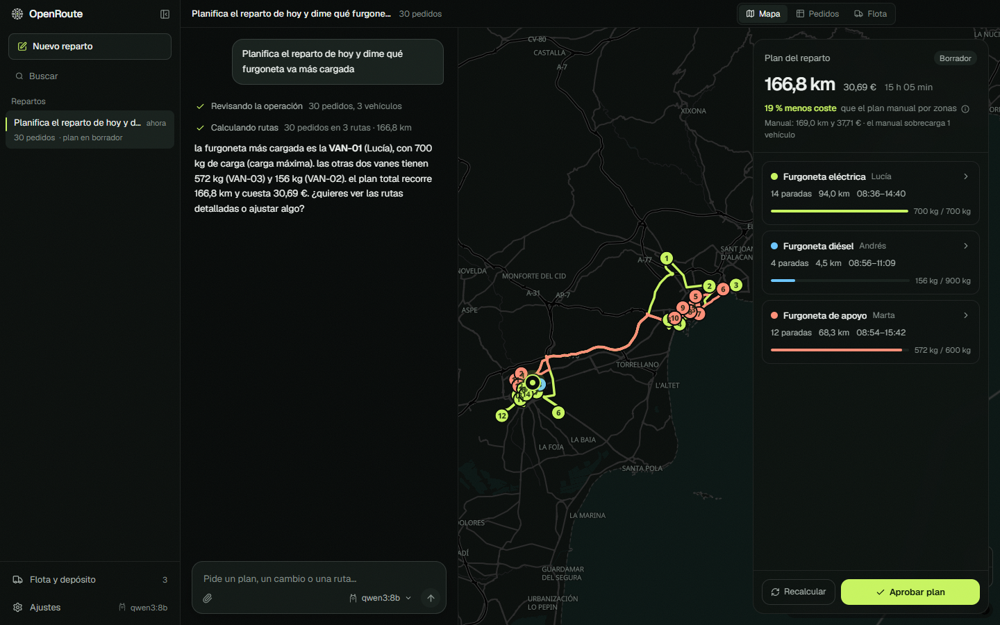
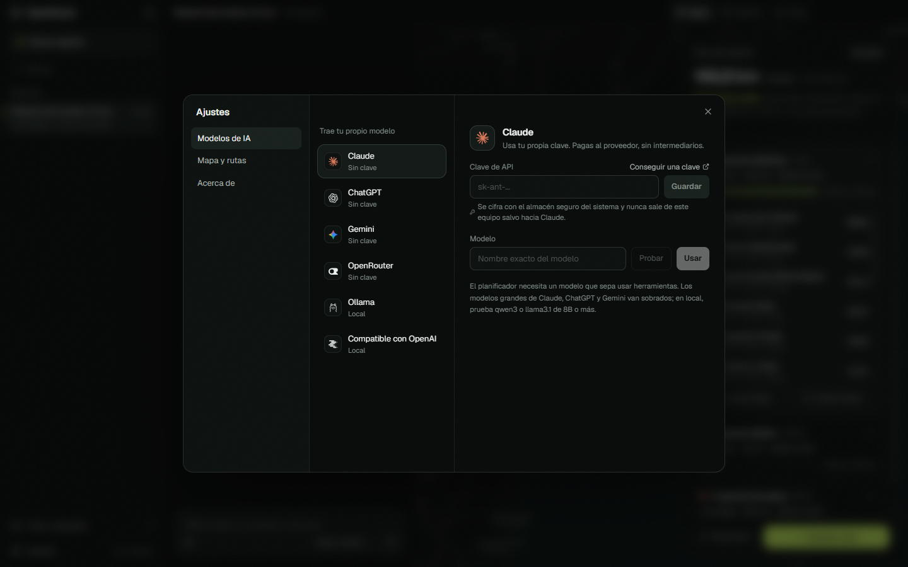

<p align="center">
  
</p>

<h1 align="center">OpenRoute</h1>

<p align="center">
  Planifica el reparto de tu flota hablando con la IA que tú elijas.<br />
  App de escritorio abierta. Sin Docker, sin servidores, sin modelos que descargar.
</p>

<p align="center">
  <a href="https://github.com/ComunidadIA-OS/OpenRoute/releases/latest/download/OpenRoute-Setup.exe"><b>Descargar para Windows</b></a>
  ·
  <a href="#desarrollo">Compilar desde el código</a>
  ·
  <a href="https://openroute.es">openroute.es</a>
</p>

<p align="center">
  
</p>

## Qué hace

- **Importa los pedidos del día** desde un CSV o un Excel, con las cabeceras que ya uses (español o inglés).
- **Calcula las rutas de toda la flota** respetando capacidad de cada vehículo, franjas de entrega, prioridades y jornada.
- **Las dibuja por calles reales** y te dice la hora de llegada a cada parada.
- **Te deja cambiarlas hablando**: «la furgoneta diésel está en el taller, replanifica sin ella», «mueve la panadería a Lucía», «¿qué pedidos urgentes llegan después de las 11?».
- **Mide el ahorro** frente a un plan manual por zonas, el que haría un jefe de tráfico con un Excel.
- **Manda cada ruta al conductor** con un enlace de Google Maps o en hojas de ruta en PDF.

## La IA entiende, el motor calcula

Los modelos de lenguaje se inventan cosas. Por eso en OpenRoute la IA nunca calcula una ruta: entiende lo que pides y usa herramientas. Las rutas, horas, kilómetros y costes salen siempre de un motor de optimización determinista escrito en TypeScript (inserción con arrepentimiento, búsqueda local y destrucción y reconstrucción). Funciona incluso sin modelo: el botón «Calcular rutas» no necesita IA.

```
Tú ──► modelo que elijas ──► herramientas ──► motor de rutas ──► mapa y plan
          (entiende)          (actúan)          (calcula)
```

Más detalle en [docs/motor.md](docs/motor.md) y [docs/arquitectura.md](docs/arquitectura.md).

## Trae tu propio modelo

Pegas tu clave en Ajustes y listo. Pagas directamente al proveedor; OpenRoute no revende nada ni pasa por intermediarios.

| Proveedor | Qué necesitas |
|---|---|
| Claude (Anthropic) | Una clave de API de [console.anthropic.com](https://console.anthropic.com/settings/keys) |
| ChatGPT (OpenAI) | Una clave de API de [platform.openai.com](https://platform.openai.com/api-keys) |
| Gemini (Google) | Una clave de [Google AI Studio](https://aistudio.google.com/apikey) |
| OpenRouter | Una clave de [openrouter.ai](https://openrouter.ai/keys) para usar cientos de modelos |
| Ollama | Ollama instalado. Todo se queda en tu ordenador |
| Compatible con OpenAI | La URL de LM Studio, vLLM, Groq, Mistral o cualquier servidor compatible |

Las claves se cifran con el almacén seguro del sistema (DPAPI en Windows, Keychain en macOS) y solo salen hacia el proveedor que elijas. Guía completa en [docs/modelos.md](docs/modelos.md).

<p align="center">
  
</p>

## Empezar en un minuto

1. [Descarga el instalador](https://github.com/ComunidadIA-OS/OpenRoute/releases/latest/download/OpenRoute-Setup.exe) y ábrelo. Windows puede avisar de que el instalador no está firmado: pulsa «Más información» y «Ejecutar de todas formas».
2. Pulsa **Probar con un ejemplo**: carga 30 pedidos de ejemplo en Alicante y Elche y una flota de tres furgonetas.
3. Pulsa **Calcular rutas**.
4. Si quieres hablar con el planificador, abre **Ajustes**, elige un proveedor y pega tu clave.

Para tus pedidos, mira el [formato de importación](docs/importar-pedidos.md).

## Privacidad

Los pedidos, la flota y los planes se guardan solo en tu ordenador. Salen de él tres cosas, y solo cuando hacen falta:

- Las direcciones sin coordenadas, hacia [Nominatim](https://nominatim.org) (OpenStreetMap) para ubicarlas en el mapa.
- Las coordenadas de las paradas, hacia el motor de rutas [OSRM](https://project-osrm.org) para medir distancias por calles.
- Lo que el modelo necesite para responderte, hacia el proveedor de IA que hayas elegido. Con Ollama no sale nada.

El servidor público de OSRM es de demostración. Para uso diario, monta el tuyo y cambia la URL en Ajustes.

## Desarrollo

Necesitas Node.js 22 o superior.

```bash
git clone https://github.com/ComunidadIA-OS/OpenRoute.git
cd OpenRoute
npm install
npm run dev
```

| Comando | Qué hace |
|---|---|
| `npm run dev` | Abre la app con recarga en caliente |
| `npm test` | Pruebas del motor, la importación y los enlaces |
| `npm run typecheck` | Comprobación de tipos |
| `npm run lint` | ESLint y Prettier |
| `npm run dist:win` | Genera `dist/OpenRoute-Setup.exe` |

En macOS y Linux, `npx electron-builder --mac` o `--linux` después de `npm run build`.

### Estructura

```
src/
  core/       Motor de rutas, importación, plan manual y enlaces. TypeScript puro, con pruebas.
  main/       Proceso principal de Electron: estado, OSRM, Nominatim, agente de IA, exportación.
  preload/    Puente seguro entre la interfaz y el proceso principal.
  renderer/   Interfaz en React: chat, mapa (MapLibre), pedidos, flota y ajustes.
  shared/     Tipos compartidos.
resources/    Icono y pedidos de ejemplo.
docs/         Documentación.
```

¿Quieres contribuir? Lee [CONTRIBUTING.md](CONTRIBUTING.md).

## Hoja de ruta

- Versión en inglés de la interfaz.
- Instaladores firmados para Windows y macOS.
- Arrastrar y soltar paradas en el mapa.
- Zonas de bajas emisiones y vehículos eléctricos con autonomía.
- Importación directa desde WooCommerce, Shopify y Holded.

La versión gestionada para empresas, con app de conductores, seguimiento para clientes y avisos por WhatsApp, está en [openroute.es](https://openroute.es).

## Licencia

Código bajo [Apache 2.0](LICENSE). El nombre OpenRoute y su logotipo son marcas de sus titulares y no se conceden con la licencia; consulta [NOTICE](NOTICE). Si haces un fork, ponle otro nombre y otro logo.

Mapa © colaboradores de [OpenStreetMap](https://www.openstreetmap.org/copyright), teselas de [OpenFreeMap](https://openfreemap.org). Iconos de proveedores de [LobeHub](https://github.com/lobehub/lobe-icons) (MIT).

---

### English

OpenRoute is an open-source desktop app that plans delivery routes for your fleet. Import today's orders from CSV or Excel, compute optimal routes (capacity, delivery windows, priorities and shifts) with a deterministic TypeScript solver, see them on a real street map, and change them by chatting with the AI model you choose: Claude, ChatGPT, Gemini, OpenRouter, Ollama or any OpenAI-compatible server. Your API keys are encrypted locally and your data stays on your computer. The interface is in Spanish for now; English is on the roadmap. Apache 2.0.
